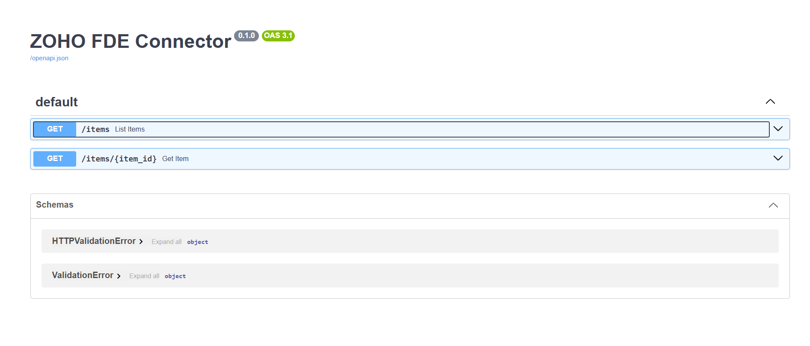

# Zoho Inventory FDE Connector

This is a production-grade FastAPI connector for Zoho Inventory, built as an Agent Studio integration for the Razorpay Forward Deployed Engineer assignment.

## Architectural Features
- **OAuth 2.0 Integration**: Connects to the Zoho Inventory API via securely injected Access Tokens.
- **In-Memory Rate Limiting**: Throttles requests to 5 per minute per IP to prevent API abuse and backend cascading failures.
- **Agent Authentication**: Secured via a custom `CONNECTOR_API_KEY` passed via Bearer token to authorize the FDE Agent.
- **Environment Management**: Secrets and dynamic routing variables are strictly managed via `python-dotenv`.
- **Container Ready**: Includes a Dockerfile for rapid deployment to client environments.

## API Documentation
FastAPI automatically generates interactive Swagger documentation for this connector.



## Setup Instructions

1. Clone the repository and navigate into the directory.
2. Create a virtual environment and install dependencies:
   ```bash
   pip install -r requirements.txt
   ```
3. Create a `.env` file based on the provided `.env.example` and populate it with your Zoho credentials:

```plaintext
ZOHO_ORG_ID=your_org_id
ZOHO_DOMAIN=zohoapis.in
ZOHO_ACCESS_TOKEN=your_oauth_access_token
CONNECTOR_API_KEY=super_secret_agent_key
```
4. Start the Uvicorn server:
```bash
uvicorn main:app --reload
```
5. Navigate to [http://127.0.0.1:8000/docs](http://127.0.0.1:8000/docs) to view the interactive UI and test endpoints directly.

## Endpoints & Agent Usage
The FDE Agent must pass the `CONNECTOR_API_KEY` in the headers for all requests:
Authorization: Bearer `<CONNECTOR_API_KEY>`
- `GET /items` - Retrieve inventory items.
- `GET /items?name={query}` - Filter inventory items by name.
- `GET /items/{item_id}` - Retrieve detailed specifications of a specific inventory item.